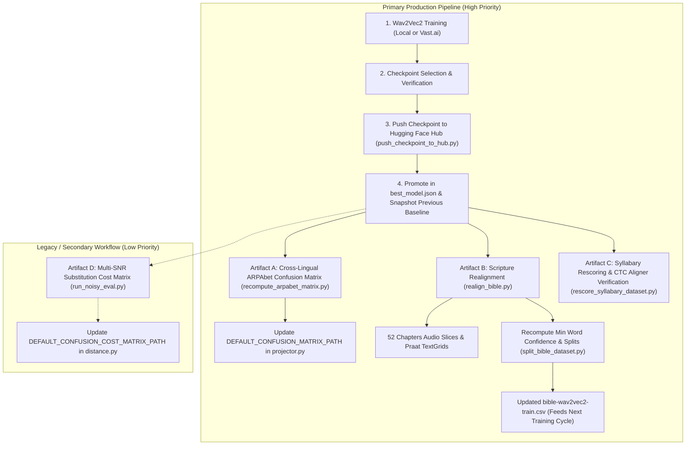

# Post-Model-Training Lifecycle and Artifact Recomputation Guide

This guide establishes the canonical, end-to-end operational procedure for promoting a newly trained Cherokee ASR model (whether single-head CTC or multi-stream dual-head CTC) and recomputing dependent downstream artifacts across the repository.

---

## 1. Executive Summary & Dependency Graph

In this architecture, the acoustic model (`CherokeeASRModel`) is the foundational Tier 2 engine. Production forced alignment across all pipelines relies on **Phonotactic CTC Segmentation** (`CTCSegmentationAligner`), while cross-lingual code-switching relies on statistical phonetic projection.

Upgrading the acoustic model governs three **primary production subsystems**:

1. **Cross-Lingual Loanword Projection**: The English-to-Cherokee synthetic target projector (`SyntheticTargetProjector`) relies on an Expectation-Maximization (EM) acoustic confusion matrix fitted against model emissions on English speech clips.
2. **Scripture Realignment & Verse Slicing**: Continuous CTC forced alignment of the New Testament (52 chapters) re-slices audio boundaries, generates Praat TextGrids, and scores verse confidences.
3. **Training Data Generation (Virtuous Feedback Loop)**: Better alignment yield increases the volume of high-confidence verses, directly feeding higher-quality training splits (`bible-wav2vec2-*.csv`) back into future training iterations.
4. **CTC Aligner Gating Verification**: Trellis transition hyperparameters (syncope penalties, intrusive consonant penalties, and blank gating) must be verified against syllabary benchmarks.

### Legacy / Secondary Subsystem:
- **Empirical Substitution Costs (`run_noisy_eval.py`)**: Dynamic Programming / DTW aligners (`NeedlemanWunschWordAligner`, `SlidingWindowDTWAligner`, `PhonologicalConfusionCostMetric`) use an empirical multi-SNR substitution cost matrix. **These DP aligners are legacy and not used in normal production pipelines.** Recomputing this matrix is **low priority** and typically skipped.

### Production vs. Legacy Dependency Flowchart



---

## 2. Artifact Recomputation Matrix

| Artifact Subsystem | Driver Script | Primary Inputs | Generated Outputs | Production Consumer | Priority |
| :--- | :--- | :--- | :--- | :--- | :--- |
| **Model Hub Deployment** | `scripts/push_checkpoint_to_hub.py` | Local checkpoint dir, processor, tokenizer, eval logs | HF Hub repo & commit revision | `best_model.json` | **P0 (Blocking)** |
| **Model Pointer Promotion** | Manual JSON update | HF Repo ID & Commit SHA | `best_model.json`, `best_model_<baseline>.json` | `CherokeeASRModel.get_best_model()` | **P0 (Blocking)** |
| **ARPAbet Confusion Matrix** | `scripts/recompute_arpabet_matrix.py` | `words_manifest.json`, 5,000 LibriSpeech word audio clips | `data/arpabet_alignment/matrices/{model_id}_confusion_matrix.json`, visual comparison plot | `digohwelisgi.cherokee.codeswitching:SyntheticTargetProjector` | **P1 (High)** |
| **Scripture Alignment & Slicing** | `scripts/realign_bible.py` | 52 NT chapter audio files, chapter JSON transcripts | Sliced verse audio (`split_audio/`), Praat TextGrids (`output_praat/`), `bible_alignment_records.json` | Scripture pipeline, verse search, desktop transcriber | **P1 (High)** |
| **Bible Training Splits** | `scripts/split_bible_dataset.py` | `bible_alignment_records.json` | `data/training/processed/bible-wav2vec2-{train,valid,test}.csv`, `train_csvs/*.csv` | Subsequent training runs (`train.py`) | **P1 (High)** |
| **CTC Aligner Benchmark** | `scripts/rescore_syllabary_dataset.py`, `scripts/tune_ctc_aligner_config.py` | `split_audio_syl_target.csv` (1,389 samples) | `rescore_syllabary_results.json`, comparative error report | CTC Aligner config verification | **P2 (Medium)** |
| **Dataset Hub Mirroring** | `scripts/upload_labels_to_hf.py` | Updated split CSVs, `vocab.json`, `vocab_tone.json` | Mirror to `charliemcvicker/cherokee-asr-data` | Remote training instances (Vast.ai) | **P3 (Optional)** |
| **Empirical Substitution Cost** | `scripts/run_noisy_eval.py` | Test split audio, multi-SNR perturbation configs | `confusion_cost_matrix.json`, `confusion_matrix.csv`, 3D manifold & heatmap plots | `digohwelisgi.cherokee.distance:PhonologicalConfusionCostMetric` (Legacy DP Aligner) | **P4 (Low / Legacy)** |

---

## 3. Retrospective: Lessons from the `feature/rebuild-artifacts` Branch

During the promotion of single-head `checkpoint-8000` (PR branch `feature/rebuild-artifacts`, tasks `TASK-391` through `TASK-394`), four critical procedural patterns were established:

1. **Preserve Baseline Pointers (`TASK-392`)**:
   Never overwrite `best_model.json` in place without archiving the previous production configuration (e.g. `best_model_pre_bible.json` or `best_model_single_head.json`). This ensures regression benchmarks and comparative visualizations (`recompute_arpabet_matrix.py`) can programmatically load both the legacy and candidate models side-by-side.

2. **Hardware Acceleration in Batch Inference (`TASK-393`)**:
   Recomputing emissions over 5,000 LibriSpeech clips on CPU took > 40 minutes. Batching inference at `--batch-size 32` on Apple Silicon (`mps`) or CUDA completed the entire 5,000-clip sweep in **24 seconds** (208 clips/sec). Always pass device acceleration when recomputing emissions.

3. **Invalidate CTC Emissions Caches**:
   `ScripturePipeline` and `CTCSegmentationAligner` cache frame logit matrices to disk (`runs/cache/ctc_emissions`). When promoting a new model, either pass `--no-cache` or delete stale cache entries under `runs/cache/ctc_emissions/` so old emissions are not mistakenly reused.

4. **Confidence Distribution Shifts Expand Training Data (`TASK-394`)**:
   Aligning the 52 New Testament chapters with `checkpoint-8000` raised the average verse confidence from 82.1% to 90.5%. When filtering by `min_word_confidence > 0.15`, accepted verses increased from **607 to 1,144** (an 88.5% increase). Re-running `scripts/split_bible_dataset.py` is essential to translate alignment improvements into an expanded training corpus.

---

## 4. Primary Production Recomputation Runbook

### Step 1: Checkpoint Evaluation & Hugging Face Promotion

#### 1.1. Select the Winning Checkpoint
Inspect training validation logs.
- **For Single-Head Models**: Select the checkpoint with lowest evaluation loss / segmental CER on validation splits.
- **For Dual-Head Models**: Select based on moraic **Tone Error Rate (TER)** / Tone CER on `valid_orig` while verifying segmental CER did not degrade.

#### 1.2. Upload Checkpoint to Hugging Face Hub
Run `scripts/push_checkpoint_to_hub.py` to stage weights, processor configs, and evaluation logs:

```bash
conda activate cherokee-asr
export PYTHONPATH=".:${PYTHONPATH}"

python scripts/push_checkpoint_to_hub.py     --checkpoint-dir output_w2v2/checkpoint-8000     --repo-id charliemcvicker/bible-augmentation-checkpoint-8000-wav2vec2-large-xlsr     --commit-message "Promote checkpoint-8000 after 50 epochs multi-domain fine-tuning"
```

Verify that the remote repository contains:
- `pytorch_model.bin` (or `model.safetensors`)
- `config.json`
- `preprocessor_config.json`
- `vocab.json` (and `vocab_tone.json` if dual-head)

#### 1.3. Promote in `best_model.json` & Archive Baseline
Snapshot the existing `best_model.json` to an appropriate comparison file:

```bash
# If replacing the pre-Bible baseline:
cp best_model.json best_model_pre_bible.json

# If replacing a single-head model with a dual-head model:
cp best_model.json best_model_single_head.json
```

Update `best_model.json` with the new repository and git commit hash:

```json
{
  "repo": "charliemcvicker/dual-tone-moraic-20261108-000631-cherokee-wav2vec2-dual-head",
  "revision": "9d45a56de29805a3789f4ae6dc8b31e1afdcb6ec"
}
```

Verify model resolution:

```bash
python -c "
from digohwelisgi.cherokee.models import CherokeeASRModel
from digohwelisgi.utils.model_utils import get_best_model_config

cfg = get_best_model_config()
print('Best model config:', cfg)
model = CherokeeASRModel.get_best_model(device='cpu')
print('Successfully instantiated model:', type(model))
"
```

---

### Step 2: Recompute Cross-Lingual ARPAbet Acoustic Confusion Matrix

The English loanword projector (`SyntheticTargetProjector`) requires an empirical Expectation-Maximization (EM) confusion matrix mapping English ARPAbet phonemes to Cherokee acoustic tokens.

#### 2.1. Run Batch Inference & EM Estimation

```bash
python scripts/recompute_arpabet_matrix.py
```

This script:
1. Loads 5,000 LibriSpeech word audio clips from `data/arpabet_alignment/words/` via `words_manifest.json`.
2. Runs batch inference (`batch_size=32`) using `CherokeeASRModel.get_best_model()`.
3. Caches emissions to `data/arpabet_alignment/cache/{model_id}_emissions.json`.
4. Initializes an articulatory feature distance prior (`build_articulatory_seed_matrix`).
5. Executes 4 iterations of Expectation-Maximization to fit transition probabilities.
6. Serializes the resulting matrix to:
   `data/arpabet_alignment/matrices/{model_id}_confusion_matrix.json`
7. Compares mappings against the baseline and outputs a side-by-side diagnostic visualization:
   `data/arpabet_alignment/visualizations/arpabet_comparison_*.png`

#### 2.2. Update Default Matrix Path in Projector
Open `digohwelisgi/cherokee/codeswitching/projector.py` and ensure `DEFAULT_CONFUSION_MATRIX_PATH` points to the newly generated matrix file:

```python
DEFAULT_CONFUSION_MATRIX_PATH = (
    PROJECT_ROOT
    / "data"
    / "arpabet_alignment"
    / "matrices"
    / "{model_id}_confusion_matrix.json"
)
```

Verify tests:

```bash
pytest digohwelisgi/cherokee/tests/test_cherokee_codeswitching.py
```

---

### Step 3: Scripture Realignment (Cherokee New Testament)

Realign all 52 chapters of the audio-backed Cherokee New Testament (Mark, Matthew, Philemon, Philippians, Titus) using continuous CTC segmentation.

#### 3.1. Purge Stale CTC Emissions Cache

```bash
rm -rf runs/cache/ctc_emissions/*
```

#### 3.2. Run Realignment across All Books

```bash
python scripts/realign_bible.py --book all
```

*(Optional: Run a single book first as a smoke test: `python scripts/realign_bible.py --book philemon`)*

This script:
- Aligns full chapter audio streams against canonical Bible JSON transcripts using `ScripturePipeline`.
- Slices individual verse audio into:
  `data/projects/cherokee_new_testament/split_audio/<book>_<ch>_<verse>.wav`
- Generates Praat TextGrids containing Word, Token, and Reconciled tiers:
  `data/projects/cherokee_new_testament/output_praat/new_testament/<book>_<ch>/alignment.TextGrid`
- Writes combined and per-book alignment records with word confidences and anomaly flags:
  `data/projects/cherokee_new_testament/alignments/bible_alignment_records.json`
  `data/projects/cherokee_new_testament/alignments/<book>_alignment_records.json`
- Generates raw per-book training CSVs:
  `data/projects/cherokee_new_testament/train_csvs/<book>.csv`

---

### Step 4: Training Split Confidence Filtering & Regeneration

#### 4.1. Filter Verses and Recompute Dataset Splits
Analyze the newly generated `bible_alignment_records.json` and partition into train/validation/test splits based on minimum word confidence:

```bash
python scripts/split_bible_dataset.py --min-word-confidence 0.15
```

This updates:
- `data/training/processed/bible-wav2vec2-train.csv` (~80% non-held-out chapters)
- `data/training/processed/bible-wav2vec2-valid.csv` (Mark 4, 11; Matthew 3, 6, 17, 19)
- `data/training/processed/bible-wav2vec2-test.csv` (Mark 7, 16; Matthew 2, 9, 20, 28)
- Per-book CSVs in `data/projects/cherokee_new_testament/train_csvs/`

#### 4.2. Verify Split Integrity

```bash
python -c "
import pandas as pd
for name in ('train', 'valid', 'test'):
    df = pd.read_csv(f'data/training/processed/bible-wav2vec2-{name}.csv')
    print(f'Bible {name}: {len(df)} samples')
    assert 'path' in df.columns and 'cv_text' in df.columns
print('Split integrity verified!')
"
```

---

### Step 5: Aligner Gating & Syllabary Rescoring Benchmarks

Ensure the new acoustic model's emissions do not degrade syllabary-guided CTC segmentation:

```bash
python scripts/rescore_syllabary_dataset.py     --csv data/training/processed/split_audio_syl_target.csv     --output data/runs/evaluation/rescore_syllabary_results.json
```

Run comparative error analysis:

```bash
python scripts/analyze_comparative_errors.py     --results data/runs/evaluation/rescore_syllabary_results.json     --output data/runs/evaluation/comparative_error_report.md
```

If the blank probability distribution or emission sharpness has changed significantly, run the hyperparameter tuning harness:

```bash
python scripts/tune_ctc_aligner_config.py
```

---

## 5. Dual-Head Multi-Stream Architecture Special Considerations

When promoting a multi-stream dual-head model (`Wav2Vec2ForDualCTC`, introduced in `TASK-400`–`TASK-407`), observe the following architectural rules:

### 1. Dual Stream Anatomy
A dual-head model simultaneously predicts two parallel token streams:
- **Head A (Segmental CV)**: 19 tokens (`[PAD]`, `[UNK]`, `|`, `'`, `a, e, i, o, u, v`, `h, k, l, m, n, s, t, w, y`).
- **Head B (Moraic Tone)**: 10 attested tokens (`[PAD]`, `[UNK]`, `|`, `C`, `1_1, 1_2, 2_1, 2_2, 3_1, 3_2`).

### 2. Virtual Head Compatibility Layer
Tier 1 aligners (`CTCSegmentationAligner`, `NeedlemanWunschWordAligner`) expect a single-stream `ASRModelProtocol`. 

`CherokeeASRModel` exposes drop-in virtual views:
- `asr_model.segmental`: Sub-view bound to Head A emissions (for segmental text alignment).
- `asr_model.tone`: Sub-view bound to Head B emissions (for tone extraction and mora analysis).

Both sub-views conform to `ASRModelProtocol` and `VirtualHeadModel`.

### 3. Rich `ModelOutput` Serialization
When caching emissions, always use `ModelOutput.save(npz_path)`. The container persists both:
- `lpz`: Segmental logit matrix $[T, V_{	ext{cv}}]$.
- `auxiliary_streams["tone"]`: Tone logit matrix $[T, V_{	ext{tone}}]$.

Never discard or slice out the tone stream during intermediate caching.

### 4. Tone Error Rate (TER) Tracking
When evaluating dual-head checkpoints, always report disaggregated metrics:
- Segmental CER on `chr-wav2vec2-test.csv` (target $< 3\%$).
- Out-of-domain Segmental CER on `bible-wav2vec2-test.csv` (target $< 4\%$).
- Moraic Tone Error Rate (TER) on `chr-wav2vec2-test.csv` (target $< 5\%$).

---

## 6. Legacy / Secondary Workflows: Empirical Substitution Costs

> [!NOTE]
> **Low Priority / Legacy Aligner Notice**:
> Production forced alignment in this codebase is performed by **Phonotactic CTC Segmentation** (`CTCSegmentationAligner`), which uses CTC posteriors, phonotactic transitions, and blank gating directly without external substitution cost tables.
> 
> The `NeedlemanWunschWordAligner`, `SlidingWindowDTWAligner`, and `PhonologicalConfusionCostMetric` are legacy DP aligners. Recomputing `confusion_cost_matrix.json` via `run_noisy_eval.py` is **low priority** and typically skipped during routine model promotions unless specifically conducting comparative DP alignment research.

If conducting legacy alignment research or calibrating the DP substitution cost engine:

### 6.1. Execute Multi-SNR Acoustic Sweep

```bash
python scripts/run_noisy_eval.py     --dataset data/training/processed/chr-wav2vec2-test.csv     --audio-dir data/training/processed/sentence_audio     --output-dir data/runs/evaluation     --output-suffix new_model     --snrs 25 20 15 10 5 0 -5
```

Outputs generated:
- `data/runs/evaluation/eval_records_new_model.jsonl`
- `data/runs/evaluation/confusion_matrix_new_model.csv`
- `data/runs/evaluation/confusion_cost_matrix_new_model.json`
- `data/runs/evaluation/confusion_vs_cost_heatmap_new_model.png`
- `data/runs/evaluation/confusion_manifold_3d_new_model.png`
- `data/runs/evaluation/snr_drift_new_model.png`

### 6.2. Update Production Substitution Cost Path (Optional)
If updating the legacy default artifact:

```bash
cp data/runs/evaluation/confusion_cost_matrix_new_model.json    data/runs/evaluation/confusion_cost_matrix.json
```

Verify distance tests:

```bash
pytest digohwelisgi/cherokee/tests/test_cherokee_distance.py
```

---

## 7. Remote Dataset Mirroring (Optional)

If preparing for remote training on Vast.ai or GPU clusters, synchronize the updated CSV splits and vocabulary files to Hugging Face Hub:

```bash
python scripts/upload_labels_to_hf.py
```

This updates the dataset repository (`charliemcvicker/cherokee-asr-data`) in seconds without re-packaging the 462 MB audio archives. Remote instances can subsequently pull the fresh labels with `scripts/fetch_training_data.py --preserve-local-csvs`.

---

## 8. Fast Operational Checklist

### Primary Production Checklist (Must Run on Model Promotion)
- [ ] Checkpoint evaluated on test splits (Segmental CER, Bible CER, Tone TER).
- [ ] Weights, configs, and vocabularies pushed to HF Hub (`push_checkpoint_to_hub.py`).
- [ ] Baseline snapshot created (`best_model_<prev>.json`).
- [ ] `best_model.json` updated with new repo and commit SHA.
- [ ] `CherokeeASRModel.get_best_model()` smoke-tested locally.
- [ ] ARPAbet confusion matrix recomputed (`recompute_arpabet_matrix.py`).
- [ ] `DEFAULT_CONFUSION_MATRIX_PATH` updated in `projector.py`.
- [ ] Stale emissions purged (`rm -rf runs/cache/ctc_emissions/*`).
- [ ] New Testament realigned (`realign_bible.py --book all`).
- [ ] Training splits recomputed (`split_bible_dataset.py --min-word-confidence 0.15`).
- [ ] Syllabary dataset rescored & error report reviewed (`rescore_syllabary_dataset.py`).
- [ ] All unit and integration tests passing (`pytest`).
- [ ] Type check passing (`pyright digohwelisgi`).

### Optional / Legacy Recomputations (Low Priority)
- [ ] Multi-SNR acoustic sweep for legacy DP substitution costs (`run_noisy_eval.py`).
- [ ] Update `DEFAULT_CONFUSION_COST_MATRIX_PATH` in `distance.py`.
- [ ] Upload lightweight labels to HF Hub (`upload_labels_to_hf.py`).
